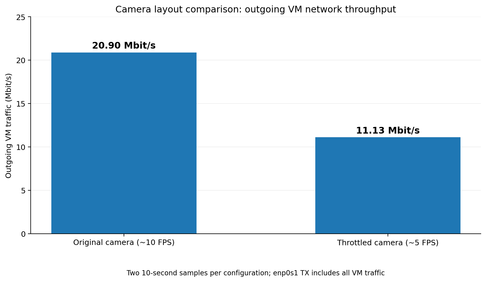

# Camera Telemetry Performance Experiment — PDR Evidence

**Date:** 2026-11-06
**Environment:** Ubuntu 24.04 ARM64 in UTM (ROS 2 Jazzy / Gazebo Harmonic), LichtBlick on macOS Apple Silicon
**Mode:** SIMULATION ONLY; no rover hardware involved
**Purpose:** Evaluate a lower-frame-rate camera stream for the operator display without modifying the original simulation camera publisher or production dashboard.

## 1. Configurations and method

| Configuration | Camera topic viewed in LichtBlick | Method |
| --- | --- | --- |
| A — original | `/sim/camera/image` | Original camera topic, approximately 10 FPS |
| B — throttled | `/perf_test/camera/image_5fps` | Test-only Python ROS 2 relay forwards every second incoming `sensor_msgs/msg/Image` message |

- Original `/sim/camera/image` continued publishing in both configurations; the test relay **did not reduce the original publisher's output**.
- The throttled stream was created with `tools/camera_throttle_test.py` in the Ubuntu test checkout. The relay subscribes to `/sim/camera/image` and publishes every second frame on `/perf_test/camera/image_5fps` using `qos_profile_sensor_data`.
- The copied LichtBlick layout `Camera Performance Test` displayed the throttled image topic. Its `camera_health` script used `/perf_test/camera/image_5fps` and `/tf` as inputs, with a 2.0-second staleness threshold; `Camera OK` was observed. The original layout displayed `/sim/camera/image`.
- ROS 2 camera frame rate and topic bandwidth were measured with `ros2 topic hz` and `ros2 topic bw` on the respective topics.
- For network measurements, LichtBlick was switched between layouts while the Ubuntu simulation and throttle relay continued running. Outgoing bytes on VM interface `enp0s1` were sampled twice, 10 seconds apart, for each configuration. Two trials were recorded per configuration.

## 2. ROS 2 camera-topic measurements

| Metric | A — original | B — throttled | Reduction |
| --- | ---: | ---: | ---: |
| Observed frame rate | 9.78 FPS | 4.78 FPS | 51.1% |
| Observed ROS 2 topic throughput | 2.22 MB/s | 1.09 MB/s | 50.9% |
| Camera freshness in LichtBlick | Original camera operation previously verified | `Camera OK` observed | — |

**Calculations** (using displayed, rounded observations):

```text
FPS reduction = (9.78 - 4.78) / 9.78 × 100 = 51.12% ≈ 51.1%
Topic-throughput reduction = (2.22 - 1.09) / 2.22 × 100 = 50.90% ≈ 50.9%
```

The ROS 2 topic-throughput figures are **not** measurements of Rosbridge WebSocket throughput. They describe the measured camera topics; the test relay adds a separate publisher and processing overhead.

## 3. VM network measurements

**Measurement:** `enp0s1` transmit (`TX`) byte counter; each sample interval was approximately 10 seconds using `sleep 10`.

| Configuration | Trial | Start TX bytes | End TX bytes | Delta bytes | Mean TX rate (Mbit/s) |
| --- | ---: | ---: | ---: | ---: | ---: |
| A — original | 1 | 23,966,551,625 | 23,992,674,192 | 26,122,567 | 20.8981 |
| A — original | 2 | 24,175,151,834 | 24,201,273,133 | 26,121,299 | 20.8970 |
| B — throttled | 1 | 23,785,013,057 | 23,798,513,809 | 13,500,752 | 10.8006 |
| B — throttled | 2 | 24,304,485,000 | 24,318,804,753 | 14,319,753 | 11.4558 |

**Formula:**

```text
Delta bytes = end TX bytes - start TX bytes
Average throughput (Mbit/s) = delta bytes × 8 / (10 seconds × 1,000,000)
```

**Worked example — A, trial 1:**

```text
Delta = 23,992,674,192 - 23,966,551,625 = 26,122,567 bytes
TX rate = 26,122,567 × 8 / (10 × 1,000,000) = 20.8981 Mbit/s
```

**Worked example — B, trial 2:**

```text
Delta = 24,318,804,753 - 24,304,485,000 = 14,319,753 bytes
TX rate = 14,319,753 × 8 / (10 × 1,000,000) = 11.4558 Mbit/s
```

**Mean across the two trials:**

```text
A mean = (20.8980536 + 20.8970392) / 2 = 20.8975464 Mbit/s
B mean = (10.8006016 + 11.4558024) / 2 = 11.1282020 Mbit/s
Observed reduction = (20.8975464 - 11.1282020) / 20.8975464 × 100
                   = 46.7488% ≈ 46.7%
```



**Result:** Across these short samples, outgoing VM traffic averaged **20.90 Mbit/s** with the original camera layout and **11.13 Mbit/s** with the throttled layout: an **observed 46.7% reduction**.

## 4. Reproduction commands

In the Ubuntu VM, with ROS 2 environment configured (`ROS_DOMAIN_ID=84` for this test session), keep the simulation and Rosbridge running. In the test checkout, start the relay:

```bash
python3 tools/camera_throttle_test.py
```

Measure ROS 2 topic rates in separate terminal commands (allow each to collect several samples; stop with Ctrl+C):

```bash
ros2 topic hz /sim/camera/image
ros2 topic bw /sim/camera/image
ros2 topic hz /perf_test/camera/image_5fps
ros2 topic bw /perf_test/camera/image_5fps
```

Select the corresponding LichtBlick layout, then record two counters:

```bash
cat /sys/class/net/enp0s1/statistics/tx_bytes
sleep 10
cat /sys/class/net/enp0s1/statistics/tx_bytes
```

Repeat with the other layout. The interface name, ROS domain, and Rosbridge endpoint are environment-specific; verify them before repeating on another machine.

## 5. Interpretation and limitations

**Verified:** The test-only topic forwarded about half the frames, reducing measured ROS 2 camera-topic throughput from 2.22 to 1.09 MB/s. LichtBlick reported `Camera OK` while monitoring the throttled topic.

**Observed, not isolated:** Total outgoing traffic on VM interface `enp0s1` was 46.7% lower on average with the throttled layout. This interface counter includes **all outgoing VM traffic**, not only camera data or Rosbridge. The experiment used two short, sequential samples per configuration; background traffic, timing, and other dashboard subscriptions were not independently controlled. Therefore, **46.7% is an observed whole-interface difference, not a proven camera-only or Rosbridge-only bandwidth saving**.

**Not evaluated:** CPU/memory cost of the relay; camera compression; end-to-end latency; network performance under rover motion; and whether approximately 5 FPS is adequate for active driving. The UTM rover remained stationary, so the unchanged scene does not demonstrate dynamic visual quality.

**Recommendation:** Treat the approximately 5 FPS stream as a **candidate telemetry setting for further testing**, not a validated operational default. Before adopting it, test with rover motion and quantify latency, operator usability, and resource usage. A production implementation should consider throttling at the source rather than relying on a duplicate-topic relay.
