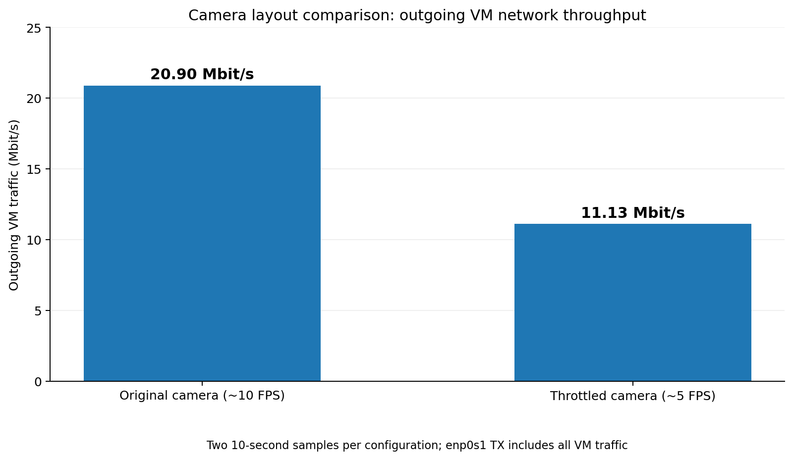

# PDR slides 9–11: LichtBlick (CDH-S2 display/recorder element)

Owners: Alice Choi + Gadadhar Parasa. ~2 min per slide. Controls and stop testing are not part of this element.

**Labels:** everything here is **SIMULATION** (live Gazebo) or **REPLAY** (MCAP of a SIMULATION run). There is no rover data until Nov 5.

**Sources:** E0 = `pdr/evidence/SIMULATED_pdr_20261104_124956/` (**main run, the OBS recording**: Gazebo GUI + LichtBlick + OBS on one laptop), E1 = `…/SIMULATED_pdr_20261104_112346/` (headless dry run, no LichtBlick), E2 = `…/SIMULATED_pdr_20261104_112151/` (run with the NO PATH event), E3 = `…/SIMULATED_gazebo_nav_20261025_183201/`, E4 = `…/SIMULATED_pdr_20261104_112442/` (timeout test), ENV = `pdr/evidence/environment.txt`.

---

## Slide 9: LichtBlick layout and software specification (CDH-S2 display/recorder element)

**Bullets**
- **Selected design (CDH-S2 display/recorder element):** LichtBlick 1.30.0 (pinned, SHA-256 checked) with one versioned layout file. Live view over Rosbridge `ws://localhost:9090`; offline replay from MCAP with no ROS needed.
- **SRR baseline:** LichtBlick is the operator display selected at SRR; unchanged since.
- **Panels:** 19 panels / 3 display-only scripts / 12 topics; every topic exists in the sim (layout validator PASS). Mission state + warnings across the top, then **CONNECTION** (source name / "Waiting for connection…") beside the health lights, then the map (largest panel, top-down view fitted to the arena) beside the camera, and three panels at the bottom. Panel → topic table: `02_Ground_Station_Telemetry/deliverables/lichtblick/panel_topics.md`.
- **Warning logic:** from `/sim/status`, LiDAR or pose older than 0.5 s, camera older than 2 s (thresholds from the autonomy code), status silent for over 1 s; obstacle stop, no path, invalid clock. Battery/E-stop/faults sit in the Details tab as **Rover-only (not in simulation)** and show UNAVAILABLE.
- **Lost data:** on a dropped link LichtBlick freezes panels at their last values (no timer in a layout), so CONNECTION sits next to every health light; stale topics on a live link turn their light red via `/tf` heartbeat.
- **Safe by design:** display only. No Teleop/Publish panels; click-to-publish redirected to inert topics. A second layout (`lichtblick_layout_gnc2027.json`) uses the GNC-2027 topics.

**Figures/tables**
- Main: `01_live_navigating.png` (OBS frame, see `pdr/screenshot_manifest.md`); `pdr/figures/layout_diagram.png` (panel → topic → type) beside it or as backup.
- Warning logic: `06_replay_no_path_warning.png` (REPLAY of E2, NO PATH at 19.926–20.212 s).
- Small: `pdr/figures/data_path.png` (Gazebo → ros_gz_bridge → ROS 2 → rosbridge ws:9090 → LichtBlick; ROS 2 → MCAP → LichtBlick replay).
- Versions (ENV): Ubuntu 24.04.5, ROS 2 Jazzy (ros-base 0.11.0), Gazebo Harmonic (gz_sim_vendor 0.0.13), ros_gz 1.0.24, rosbridge_server 2.7.1, rosbag2 + MCAP 0.26.11, LichtBlick 1.30.0.

**Speaker notes (~2 min)**
> Our ground station is LichtBlick 1.30.0 with one layout file that we version-control. It connects live over Rosbridge, or opens a recorded MCAP file with no ROS install at all, which is how Vin can review runs on any laptop. LichtBlick is the display we selected at SRR, and that choice hasn't changed. The layout puts mission state and warnings across the top, so the operator sees what the rover is doing and whether anything is wrong at a glance. Warnings come from the navigator's own status message, with the same 0.5-second staleness limits the autonomy code uses. Next to the health lights is a connection panel: if the link drops, LichtBlick freezes every panel at its last value, so that panel saying 'Waiting for connection' is how the operator knows the lights are no longer live. Then the map gets most of the screen, zoomed to fit the arena. Battery, E-stop and faults don't exist in simulation, so they live in a Details tab marked rover-only and show UNAVAILABLE rather than blank. It's display-only: no panel can send commands, and we redirected the click-to-publish tool so a stray click can't send a goal. This merges Alice's dashboard: her transform preloading, plot settings and her troubleshooting from a live test on macOS.

---

## Slide 10: LichtBlick telemetry and replay

**Bullets**
- **Live load:** the layout's topics come to **19.15 Mbit/s** over Rosbridge (E0, `rosbridge_bandwidth.json`). The raw camera is **18.07 Mbit/s** of it; everything else is ≈ 1.08 Mbit/s (sum of the non-camera rows). Headless E1 measured 19.36 / 18.26.
- **Link margin:** −9.15 Mbit/s (192 %) against a **PLACEHOLDER 10 Mbit/s** link (E0). The number is a placeholder until Sabu + Robin's network numbers arrive. Either way, the raw camera needs compression or throttling on the rover.
- **Recording:** `ros2 bag record` (MCAP) of 12 topics at **148.9 MB/min** uncompressed (E0; all runs 148.8–149.1), ≈ 8.9 GB per hour (149 × 60).
- **Replay is faithful:** replayed on an isolated ROS domain and re-recorded: all 11 topics, every message back, header stamps identical, 0 losses (E0; also E1–E3).
- **Rosbridge is the bottleneck:** with LichtBlick connected it used **≈ 107 % of one core** (≈ 114 % while the measurement probe also ran) and delivered `/clock` at 434 Hz instead of 500 (E0). All other topics reached LichtBlick at 96–99 % of the recorded rate.

**Table: telemetry topics** (E0 `summary.md` + `rosbridge_bandwidth.json`)

| Topic | Type | Expected Hz | Recorded Hz | Live kbit/s |
| --- | --- | --- | --- | --- |
| `/sim/camera/image` | Image | 10 | 9.99 | 18,070.1 |
| `/sim/scan` | LaserScan | 10 | 9.98 | 461.5 |
| `/clock` | Clock | 100 (topics.csv) | 500.00 | 243.1 |
| `/sim/odom` | Odometry | 30 | 29.41 | 181.3 |
| `/sim/obstacle_grid` | OccupancyGrid | 2 | 1.98 | 55.5 |
| `/sim/status` | String (JSON) | 20 | 19.02 | 48.4 |
| `/tf` | TFMessage | — | 29.41 | 35.7 |
| `/sim/camera/camera_info` | CameraInfo | 10 | 10.00 | 35.2 |
| `/sim/cmd_vel` | Twist | 20 | 19.02 | 17.6 |
| `/sim/planned_path` | Path | 2 | 1.98 | 3.9 |

Also recorded but not used by the layout: `/sim/imu` (100 Hz, 259.2 kbit/s recorded), `/tf_static` (3 latched messages).

**Procedure (3 steps)**
1. `bash tools/run_pdr_demo.sh`: starts the sim and the recorder together and stops both when the goal is reached (SIM UP / RECORDING / GOAL REACHED / STOPPED banners).
2. LichtBlick → **File → Open local file(s)…** → `SIMULATED_pdr_<time>.mcap` → **View → Import layout from file…**.
3. Check it: `python3 tools/verify_mcap.py <recording> --label REPLAY` (or SIMULATION / rover label).

**Figures:**
- `E0/bandwidth_per_topic.png` (original resource budget).
- `03_terminal_banners.png`, `09_bag_info.png`, `04_replay_mid_drive.png` (see `pdr/screenshot_manifest.md`).
- `pdr/evidence/camera_network_comparison.png` (Nov 6 camera throttling experiment; original vs. throttled VM network traffic). Full measurements and calculations: `pdr/evidence/camera_performance.md`.


**Resources (E0 `resources.csv`, CPU % of one core, mean / max, RSS max; 24-core laptop, desktop load):**

| Process | CPU mean / max | RSS max |
| --- | --- | --- |
| rosbridge (**LichtBlick + measurement probe**) | 102.7 / 115.6 % over the run; ≈ 107.5 % with LichtBlick only (12:50:18–12:50:42), ≈ 114.3 % while the probe also ran (12:50:07–12:50:17) | 100.6 MB |
| recorder | 35.7 / 43.8 % | 84.9 MB |
| navigator | 70.5 / 101.2 % | 79.2 MB |
| ros_gz bridge | 50.6 / 59.9 % | 60.9 MB |
| Gazebo (with GUI) | 221.3 / 253.4 % | 587.1 MB |

The probe/LichtBlick split comes from time windows in one run (estimate). Laptop numbers, not the Jetson; the Jetson budget is TBD (Sameer + Zosia).

**Speaker notes (~2 min)**
> This is what the display costs. LichtBlick pulls about 19 megabits per second over Rosbridge, and almost all of that, 18, is the raw simulated camera. Everything else together is about 1.1. Against a placeholder 10-megabit link we'd be at nearly 200 percent. That number will change when Sabu and Robin give us the measured link, but the conclusion holds: the camera has to be compressed or throttled before it goes over the radio. The other finding is CPU: Rosbridge used about one full core serving LichtBlick, and at that load it delivered the 500 Hz sim clock at only 434 Hz, while every sensor topic arrived at 96 to 99 percent of its rate. So Rosbridge on the Jetson is something to budget for. Recording uses the team's standard ros2 bag recorder at about 149 megabytes a minute. Replay is faithful: we replayed the recording on an isolated ROS network and recorded it again, and every message came back with the same timestamps. That's what lets us review runs afterwards and train operators without the rover.

---

## Slide 11: LichtBlick run evidence

**Requirement check (CDH-S2 display/recorder element)**: pass criterion: the operator can load the layout, connect live, identify source/mode/freshness, recognize lost data (a frozen value must not look live and healthy), and replay a saved recording.

| Requirement | Observed outcome | Label | Status | Evidence |
| --- | --- | --- | --- | --- |
| Load layout | Merged layout imports and renders in LichtBlick 1.30.0 (desktop, Linux); validator PASS (19 panels, 12 topics); revised layout seen working in the LichtBlick web app (version unknown) in the NO PATH screenshot at 20.03 s | SIMULATION, REPLAY | PASS | `pdr/evidence/LICHTBLICK_APP_layout_import_2026-11-04/`, `screenshot_manifest.md` |
| Connect live | LichtBlick on `ws://localhost:9090` during run 124956; all layout topics delivered at 96–99 % of recorded rate except `/clock` (87 %) | SIMULATION | PASS (data); OBS video | `E0/summary.md` live parity, OBS video |
| Identify source / mode / freshness | CONNECTION shows `ws://…` or the `.mcap` name; DATA ORIGIN SIMULATED; health lights + Data age | SIMULATION, REPLAY | PARTIAL — Nov 6 live health indicators verified; full source/mode and replay identification not independently tested | `pdr/evidence/fault_tests.md`; `02_Ground_Station_Telemetry/deliverables/lichtblick/test_notes.md` |
| Recognize lost data | Fault tests A (link lost), B (camera missing), C (stale status); faults verified at ROS level (camera gap 9.4 s, status gap 10.4 s) | SIMULATION | PASS — Nov 6 live visual checks by Alice (A/B/C); B used a temporary camera relay | `pdr/evidence/fault_tests.md`; `02_Ground_Station_Telemetry/deliverables/lichtblick/test_notes.md` |
| Replay saved recording | MCAP replayed on isolated domain: 11 topics, 0 losses, stamps identical; opened in LichtBlick (NO PATH shown at 20.03 s of run 112151); `record_replay.sh replay` (ros2 bag play) delivers over Rosbridge | REPLAY | PASS | `E0/summary.md` replay parity, `evidence_location.md` |
| Same five on the rover | — | EXISTING-ROVER (TBD) | **PENDING (Vin)**: same run ID for rover footage and MCAP | `evidence_location.md` |

**Additional live fault verification — 2026-11-06 (Alice, SIMULATION on macOS + Ubuntu ARM64/UTM):** The imported Operator layout displayed Camera OK and Status OK with live Gazebo telemetry. **A (Rosbridge disconnect):** the client reported connection loss and recovered when Rosbridge was restarted; this is a connection-level warning, not a guarantee that frozen panel values turn stale. **B (camera staleness):** a copied test layout monitored `/fault_test/camera/image`, relayed from `/sim/camera/image` at approximately 10 Hz. Stopping only the relay produced red Camera STALE, script state `STALE`, and camera age above 2 s; restarting it restored green Camera OK, state `OK`, and age below 2 s. This validates camera-health logic, **not physical camera failure or the unmodified layout's response to a real camera outage**. **C (status staleness):** stopping the navigator while the `/tf` heartbeat continued produced red Status STALE and associated warnings; restarting the navigator restored Status OK. These checks do not resolve the separate recorded-data verification FAILs below or the pending real-rover check. No new screenshots or MCAP artifacts are claimed for this session.

**Run metadata** (all SIMULATION; E0–E4 `summary.json`)

| Run | Date | Duration | Size | Messages | Goal | Distance | Notes |
| --- | --- | --- | --- | --- | --- | --- | --- |
| **E0 `SIMULATED_pdr_20261104_124956`** | 2026-11-04 | 42.9 s | 106.4 MB | 31,335 | reached at 37.65 s | 5.67 m | **main run = the OBS video**; Gazebo GUI + LichtBlick + OBS on one laptop |
| E1 `SIMULATED_pdr_20261104_112346` | 2026-11-04 | 42.5 s | 105.6 MB | 31,137 | reached at 37.35 s | 5.66 m | headless, no LichtBlick; comparison |
| E2 `SIMULATED_pdr_20261104_112151` | 2026-11-04 | 58.5 s | 145.0 MB | 42,751 | reached at 38.2 s | 5.66 m | real NO PATH event 19.9–20.2 s |
| E3 `SIMULATED_gazebo_nav_20261025_183201` | 2026-10-25 | 63.9 s | 158.4 MB | 46,775 | reached at 37.1 s | 5.66 m | earlier recording; replay parity |
| E4 `SIMULATED_pdr_20261104_112442` | 2026-11-04 | 12.1 s | 30.1 MB | 8,846 | not reached (5 s timeout test) | 2.26 m | launcher timeout path |

**Pass/fail** (verify_mcap.py; overall FAIL in every run, for the reasons below)

| Check | E0 (OBS run) | E1 | E2 | E3 | E4 |
| --- | --- | --- | --- | --- | --- |
| Layout topics present (coverage) | PASS 100 % | PASS 100 % | PASS 100 % | PASS 100 % | PASS 100 % |
| TF tree connected, clock monotonic | PASS | PASS | PASS | PASS | PASS |
| Live vs recording rates (±10 %) | FAIL `/clock` only (434 vs 500 Hz); others 96–99 % | PASS | PASS | not measured | not measured |
| Replay parity (isolated domain) | PASS, 0 losses | PASS | PASS | PASS | not run |
| Per-topic rate within 20 % | FAIL `/clock` only | FAIL `/clock` only | FAIL `/clock` only | FAIL `/clock` only | FAIL `/clock` only |
| No gap over 3× period | FAIL cmd_vel, status (max 0.668 s); clock, imu (≤ 0.056 s at 0.6–0.7 s) | FAIL cmd_vel, status | FAIL clock, camera ×2, imu, odom (all at t ≈ 0) + cmd_vel, status | FAIL cmd_vel, status | FAIL cmd_vel, status |

**What the FAILs mean**
- `/clock` publishes at 500 Hz; `topics.csv` says 100 Hz. The config value is out of date (sent to Sabu), not a data fault.
- `/sim/cmd_vel` and `/sim/status` (20 Hz navigator timer) have gaps: up to 0.668 s in E0 (at 15.4 s), 0.396 s in headless E1. Below the display's 1 s STATUS STALE threshold, so no false alarm, but real jitter (open action).
- **E0 ran under desktop load:** Gazebo GUI + LichtBlick + OBS on one laptop (system CPU mean 33.9 % vs 8.9 % headless). Its larger navigator gaps, the short `/clock`/`/sim/imu` gaps and the WAITING FOR SENSORS blip at 15.83–15.92 s are under that load and **not representative of the rover**. Rosbridge at ≈ 1 core (LichtBlick + measurement probe) also explains the live `/clock` shortfall.
- E2's sensor gaps all occur at t ≈ 0 (start-up); that run's recorder also logged 93 messages lost on the transport layer.

**Figures:** `E0/xy_path.png` (rover path vs planned path, start/goal), `E0/topic_rates.png`, `E0/gap_timeline.png`; screenshots `05_replay_goal_reached.png` and `06_replay_no_path_warning.png` (see `pdr/screenshot_manifest.md`).

**Nov 5 data from Vin: PLACEHOLDER**
- Label: `EXISTING-ROVER MANUAL` or `EXISTING-ROVER AUTONOMOUS` (TBD by Vin)
- Duration / size / topics / rates / coverage: TBD
- Command (rover topic names differ from `/sim/*`, so pass their expected rates if known):
  ```bash
  source /opt/ros/jazzy/setup.bash
  ~/.venvs/lunabotics-pdr/bin/python tools/verify_mcap.py /path/to/vin_nov5.mcap \
      --label "EXISTING-ROVER MANUAL" --name ROVER_nov5 \
      [--expected-rates rover_rates.csv] [--replay-parity]
  ```
  Expect layout coverage below 100 % until real topic names are added to `rover_only_topics.txt` and the layout.

**Speaker notes (~2 min)**
> Here's the evidence, all from simulation. The main run is the one in our video: the rover reaches the goal at 37.65 seconds after 5.67 metres, and the earlier runs agree to within a few tenths of a second. Every topic the layout needs is in every recording, the transform tree is connected, the clock is clean, and replay reproduces the recording exactly. The plot shows the rover's odometry path against the planner's path from start to goal. The checker is strict and marks every run FAIL, for two real reasons we're reporting rather than hiding. First, the topic list says the simulation clock runs at 100 Hz, but it runs at 500. That's a documentation fix. Second, the navigator's 20 Hz status occasionally pauses, up to 0.67 seconds in the video run. That run had Gazebo's window, LichtBlick and OBS all on one laptop, so treat those gaps, and a brief waiting-for-sensors blip, as desktop load, not rover behaviour; headless the worst gap was 0.4 seconds. Both are below our 1-second stale threshold, but we'll track it. In one run the planner briefly lost its path for 0.3 seconds, and the display turned red with NO PATH, which shows the warning logic on a real event. Separately, Alice verified live visual warnings and recovery for Rosbridge loss, status staleness, and camera staleness using a temporary camera relay in a copied layout on Nov 6. On Nov 5 Vin gives us real rover data and we rerun the same tool on it; that's this placeholder.

---

## Open actions

| # | Action | Owner |
| --- | --- | --- |
| 1 | Capture the screenshots in `pdr/screenshot_manifest.md` (replay shots from Steps 2–5 and OBS frames) and confirm the revised layout's top-down map and collapsed legends on screen | Gadadhar |
| 2 | Measured rover ↔ operator bandwidth/latency to replace the 10 Mbit/s placeholder (slides 6–8) | Sabu + Robin |
| 3 | Finalize camera compression/throttling for the rover. Nov 6 simulation test reduced camera output from ~10 to ~5 FPS and measured VM network traffic by 46.7%; moving-rover testing and real-link validation remain pending. See `pdr/evidence/camera_performance.md`. | Sabu + Robin, Gadadhar + Alice |
| 4 | Real Unitree L2 LiDAR and Orbbec topic names/types/rates → `rover_only_topics.txt` and layout | Sabu + Robin |
| 5 | Real rover dimensions for the footprint (now 0.65 × 0.45 m sim values) | Vin / Sameer + Zosia |
| 6 | Jetson compute and storage budget (rosbridge + recorder measured only on a laptop) | Sameer + Zosia |
| 7 | Fix `/clock` expected rate in `topics.csv` (100 → measured 500 Hz in sim) | Sabu |
| 8 | Navigator 20 Hz timer jitter (gaps up to 0.396 s headless, 0.668 s under desktop load) | GNC / MAIN (TBD) |
| 9 | Rosbridge CPU on the Jetson: ≈ 1 core on the laptop with LichtBlick connected; consider dropping `/clock` from the live view or throttling it | Sameer + Zosia, Gadadhar |
| 10 | Run `verify_mcap.py` on Vin's Nov 5 data and fill the slide 11 placeholder | Gadadhar + Alice |
| 11 | Battery, E-stop and fault topics so those panels stop showing UNAVAILABLE | Embedded (TBD) |

---

## Backup / reference (not for the main slides)

Prior-season history: the 2025-26 CDH "ROS2 Frontend Interface Study" (10/14/2025) compared SSH/CLI and Dear PyGui front ends. It is **not** this season's baseline; the 2026-27 SRR selected LichtBlick.
